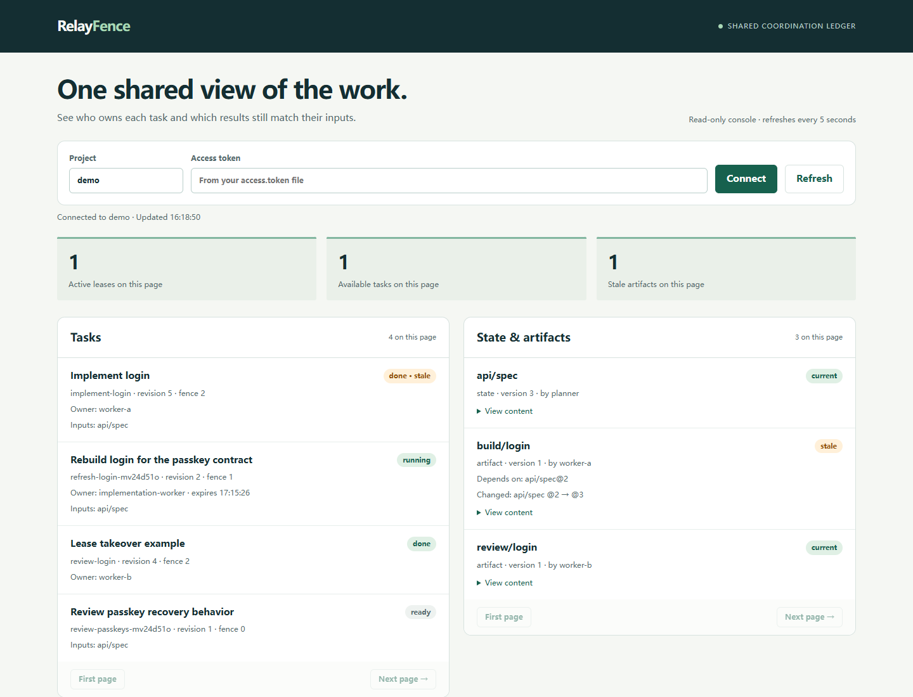
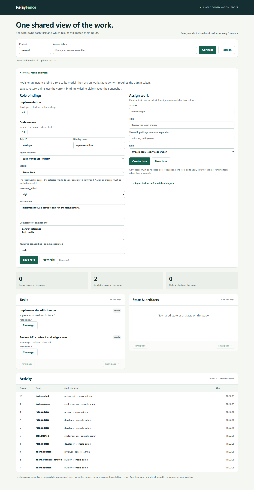

# RelayFence

**Shared state and safe handoffs for coding agents that do not share a runtime.**

[中文文档](README.zh-CN.md) · [Roles & models](docs/roles-and-models.md) · [Connect your clients](docs/clients.md) · [Protocol](docs/protocol.md)

You change an API contract in one agent. Another agent finishes tests against the old contract. A disconnected worker comes back and submits over its replacement. A retry publishes the same result twice.

RelayFence puts these handoffs through a small, transactional coordination service. Different MCP clients can share a project, claim work, read versioned inputs, and publish results that are checked against those inputs. Each client keeps its own model, tools, conversation and execution environment.

**v0.2 is an alpha for cooperating agents on one trusted machine.** It provides an authenticated loopback MCP/HTTP server, SQLite persistence, a Python client, a stdio bridge, role/model configuration in the console, and an explicit local command worker. The service and demos make no model calls and require no model API key.

## What it enforces

| Situation | Result |
| --- | --- |
| Two clients claim the same task | One receives the lease; the other gets `task_busy`. |
| Two clients write the same state version | One succeeds; the other gets `version_conflict`. |
| A worker's input changes before completion | The entire completion is rejected with `stale_input`. |
| A lease expires and another worker takes over | The old fence/token can no longer complete or renew the task. |
| The result commits but its response is lost | An exact retry returns the saved receipt, without another write. |
| An upstream input changes after publication | Reading the dependent artifact reports it as stale, including transitive dependencies. |
| The service process dies | Committed state, events and receipts survive; incomplete transactions roll back. |
| A different instance tries to claim assigned work | Its credential cannot impersonate the assigned instance. |
| A role selects an unavailable catalogue model or parameter | Configuration/claim is rejected with no silent fallback. |
| A role binding changes during execution | Running work retains its original role/model snapshot; future claims use the new binding. |

These guarantees apply to the ledger. External file writes, merges, deployments and messages need their own controls. Use separate Git worktrees for parallel coding.

## Choose an agent and model for each role

In the console, register an **agent instance**, configure its available model IDs and parameter options, then issue its own credential. Create a **role** with instructions and deliverables, select the instance, select a model, and assign tasks to that role. The same software can have multiple instances with different models.

External MCP sessions configure their models in their own client; RelayFence does not switch external conversations. The optional `relayfence worker` command passes the selected model to an operator-configured local adapter and renews the task lease while it runs. Model catalogues are manually configured, and model reports remain explicitly unverified or worker-reported. There are no bundled vendor launchers.

Run a real HTTP/subprocess handoff with two **demo model labels** and no LLM calls:

~~~bash
uv run python examples/role_models.py
~~~

See [the role/model guide](docs/roles-and-models.md) for console steps, instance credentials, the command adapter contract, and recovery.

## Run the real demo

Requires Python 3.11+ and [uv](https://docs.astral.sh/uv/getting-started/installation/).

~~~bash
git clone https://github.com/shyangar/relayfence.git
cd relayfence
uv sync --locked
uv run relayfence demo
~~~

The demo launches a real server process and three MCP protocol clients. It races claims, changes a contract during work, retries a completion, demonstrates invalidation and lease takeover, then forcibly terminates and restarts the server.

~~~text
[PASS] exclusive-claim
[PASS] stale-input
[PASS] idempotent-retry
[PASS] artifact-freshness
[PASS] fenced-takeover
[PASS] crash-recovery
~~~

Each run writes a report and persistent ledger into a new `.relayfence/demo-*` directory. The final command printed by the demo lets you reopen it in the console. **These are real protocol clients, not live Codex, ZCode or DSH sessions.**

## Start a shared workspace

~~~bash
uv run relayfence init
uv run relayfence serve
~~~

Keep the server running. The console is at **http://127.0.0.1:7433/** and MCP is at **http://127.0.0.1:7433/mcp**. Open the local `.relayfence/access.token` file and paste its value into the console. The console keeps it only in tab memory.

From a second terminal, print the appropriate client configuration:

~~~bash
uv run relayfence config codex
uv run relayfence config zcode
uv run relayfence config dsh
~~~

The generated snippets use absolute paths and a stdio bridge to **the same running service**. They contain a token file path, not a token value. Merge the relevant snippet into the client's existing configuration; the command does not change any client settings. Restart/reconnect that client's MCP connection.

[The client guide](docs/clients.md) also covers direct Streamable HTTP, setup locations, and the verification matrix. All clients must use the same service URL and project name.

## A normal work cycle

~~~mermaid
flowchart LR
  A[Codex / ZCode / DSH] -->|MCP or stdio bridge| R[RelayFence]
  P[Python / HTTP clients] --> R
  R --> L[(SQLite ledger)]
  R --> C[Roles, models and work console]
~~~

1. Write a shared input with `state_put` and its `expected_version`; `0` means the key must not exist.
2. Create a task with the **keys of every shared input** it will use.
3. Claim it. RelayFence atomically captures current input values/versions and returns a lease token and increasing fence number.
4. Work from that snapshot, renewing the lease before it expires.
5. Complete with artifact values and their expected versions. Input validation, output writes, task completion, receipt and event commit together.
6. On `stale_input`, release and claim again, then recompute. On `lease_lost` or `lease_expired`, stop using the old lease.

For code, artifact values can contain a commit SHA, test report or file digest. RelayFence stores the supplied JSON; it does not run the tests or verify the referenced Git objects.

See the runnable [Python handoff example](examples/python_handoff.py) and [agent instructions](examples/agent-instructions.md).

## Small enough to maintain

- One authoritative service and a local SQLite file; no Redis, model runtime, vector database or background scheduler.
- One request contract shared by MCP, HTTP and the Python client.
- Immutable revisions, monotonic task fences, bounded dependency traversal, and durable retry receipts.
- No provider SDK dependency. The stdio bridge keeps client-specific integration outside the ledger.
- An online backup command, explicit schema version, locked dependencies, and tests for process races and crash boundaries.

~~~bash
uv run pytest --cov=relayfence --cov-report=term-missing
uv run ruff check .
uv run ruff format --check .
uv build
~~~

The package is installable from source or the GitHub release wheel. It is **not published to PyPI** at this stage.

## Scope and trust

The admin token grants access to the entire service. Instance credentials bind one project and actor and cannot modify registry/assignment settings. A project remains a trusted shared workspace: its instances can read its data and cooperate on shared state. Legacy unregistered actors retain the service-token workflow. Keep credentials, run directories and databases private; use separate services for untrusted teams.

The HTTP/MCP service does not automatically launch, wake or stop agent software. Local execution requires an explicit `relayfence worker` command with a trusted local adapter. Clients must choose to call tools and poll events. The ledger tracks only declared dependencies and writes made through its API. There is no multi-host replication, external side-effect exactly-once guarantee, automatic conflict merge, or semantic correctness judgment.

Before upgrading from v0.1, back up and stop the old service. Opening the ledger in v0.2 transactionally migrates it to schema 2 while preserving old fences and receipt hashes. The upgraded ledger cannot be reopened with v0.1.

Read [operations and recovery](docs/operations.md), [security](SECURITY.md), and [contributing](CONTRIBUTING.md) before extending it. RelayFence is an independent project with no dependency on FlowTrial.
