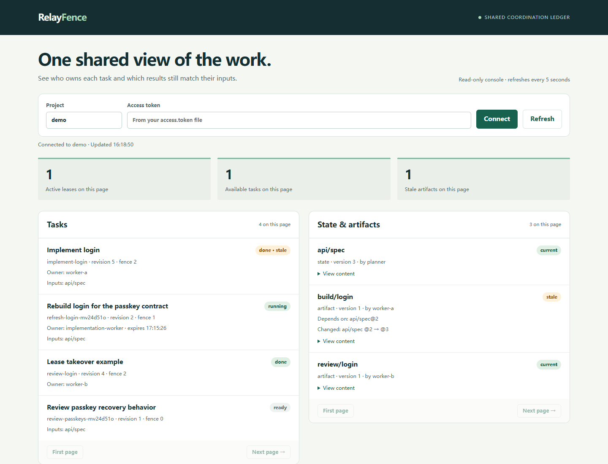
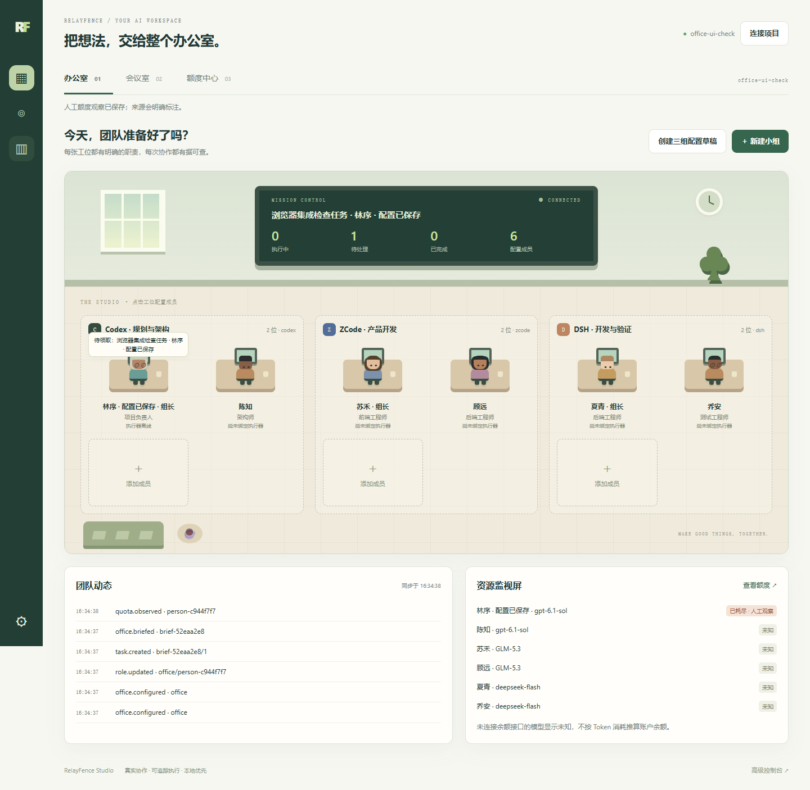
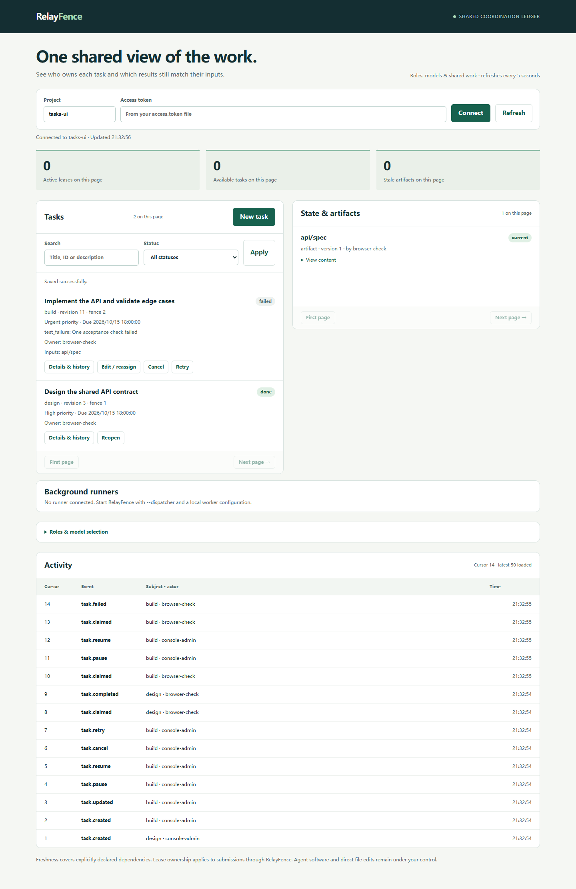
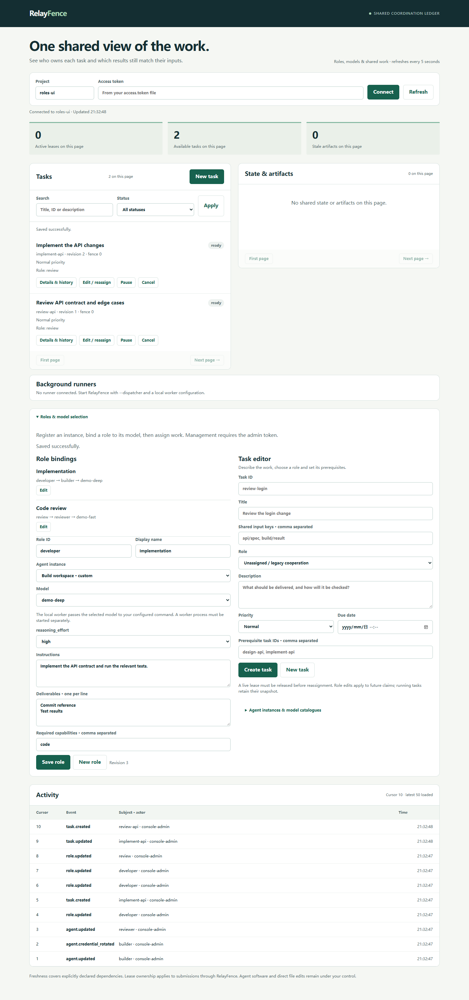

# RelayFence

**让不同 Agent 软件共享状态、领取任务，并在提交结果前检查输入是否过期。**

[English](README.md) · [任务管理与后台运行](docs/task-management.md) · [角色与模型配置](docs/roles-and-models.md) · [三端接入](docs/clients.md) · [接口协议](docs/protocol.md)

实际协作中，问题往往出在交接处：Codex 更新了接口约定，另一个 Agent 仍按旧约定写测试；一个任务同时被两个客户端领取；掉线的 Agent 恢复后覆盖了接手者的结果；请求超时后重试，导致重复发布。

RelayFence 把这些交接变成可检查的操作。不同软件连接同一个协调服务，各自保留模型、工具和对话，只共享任务、输入版本、产物与事件记录。

当前是 **v0.3 alpha**：适合一台可信机器上的协作工作流。包含 MCP/HTTP 服务、SQLite 持久化、Python 客户端、stdio 桥接、角色与模型配置面板、任务管理、后台调度、内置 Codex 适配器和故障演示。核心服务与演示不调用模型，不需要模型 API Key。

## AI 办公室预览

首页现为游戏风格办公室：按软件分组、配置人物与工位，在会议室将简报转为真实任务，并在额度屏中显示数据来源与时效。旧控制台保留在 `/console`。

已实现额度观察、同软件优先的路线选择，以及携带检查点的显式交接。新增**团队管理**分页，汇总每个项目保存的小组，支持新建、重命名、删除，并可从其他项目选择已有小组导入当前办公室；删除小组不会取消已派发任务。**持续额度探测、无人值守自动故障转移和原生子 Agent 控制仍未完成**；独立 CLI 会话不会被冒充为原生子 Agent。详见[办公室使用说明与能力边界](docs/office.md)。

任务指挥台新增交付看板、按执行尝试分页的档案和人工验收。新会议默认要求成员交付经用户验收后再解锁依赖；驳回保留结果与返工要求并暂停任务。团队管理显示各成员的实际负载，手动交接会保存接手者可读取的结构化交接单。旧任务和 API 默认行为保持兼容。参考来源、实现规则与边界见[开源工作流优化说明](docs/open-source-patterns.md)。

自动连接的项目使用**项目级固定原生会话**：每个项目、每种智能体软件首次实际执行时建立专用会话，后续任务按保存的会话 ID 续接。小组、成员、模型配置不会让同一软件重复创建会话；不同项目保持隔离。办公室显示会话绑定与调用次数，支持显式归档重建。该功能控制后台原生会话，桌面窗口的自动打开和聚焦尚未接入，详见[项目会话说明](docs/office.md#project-owned-native-conversations)。

## 新增任务管理与后台运行

- 创建、编辑任务：说明、优先级、截止时间、角色和前置任务。
- 按状态和关键词筛选，查看任务详情、产物、失败原因及完整事件历史。
- 暂停、恢复、取消、重试、重新打开；暂停或取消会撤销旧租约。
- 前置任务未完成、输入缺失或过期时显示阻塞原因，条件满足后自动进入可运行状态。
- 后台执行器按优先级和截止时间领取任务；办公室成员通过有界并发槽位并行执行，同一供应商的多名成员也能同时工作。需要同时修改相同文件时，仍建议使用独立 worktree。
- `setup-codex` 一次生成实例、角色、凭证和后台配置；之后不必逐个打开桌面软件或手动发送任务。
- 续租与本地进程监控独立运行；Windows 用 Job Object 管理子进程树，Linux/macOS 使用进程组；调度器并发轮询、复用连接并对故障独立退避。详见[进程与通信机制](docs/process-lifecycle.md)。

首次配置需要已安装并登录的 Codex CLI，具体命令和运行边界见[任务管理指南](docs/task-management.md)。Codex 返回“受阻”或“失败”会保留为失败任务，不会当作成功发布。默认保留只读沙箱，需要改文件时显式选择 `workspace-write`。

## 已实现什么

| 能力 | 实际行为 |
| --- | --- |
| 共享状态版本控制 | 更新时携带预期版本，拒绝覆盖已经变化的数据。 |
| 原子领取任务 | 多个进程竞争同一个任务，只允许一个持有有效租约。 |
| 租约与 fencing | 每次接管递增版本号；旧租约不能续租或提交。 |
| 输入快照 | 领取时同时记录输入内容及版本，提交时重新校验。 |
| 产物依赖 | 上游状态变化后，下游产物查询结果显示过期，支持传递依赖。 |
| 幂等重试 | 同一请求 ID、同一内容返回原始成功回执，不重复写入。 |
| 故障恢复 | 已提交数据保留，未提交事务回滚，事件和回执随数据库恢复。 |
| 角色与模型选择 | 每个角色独立选择 Agent 实例、模型及其支持的参数，并设置工作说明和交付要求。 |
| 实例身份 | 每个实例使用独立凭证；冒用实例名、跨项目访问、越权修改配置会被拒绝。 |
| 执行配置快照 | 领取时固定角色与模型配置；执行中的任务不受之后的角色修改影响。 |
| 本地命令执行 | 显式 worker 命令把模型传给本地适配器，自动续租，通过原有接口提交结果。 |
| 控制台 | 配置角色、Agent 与模型，分派任务，查看负责人、租约、产物及执行记录。 |

这些约束作用于 RelayFence 的提交接口。办公室默认并行派发成员任务；如果多个成员会修改同一批文件，仍应让它们使用独立 Git worktree，再以提交 SHA 或测试报告交接。项目业务数据、本地项目索引、事件、成员引导和小组日志统一保存在项目 SQLite 账本中；私有 worker 配置与凭证文件仍作为受限的本地输入单独保存。

## 为每个角色选择 Agent 和模型

启动服务并连接控制台后：

1. 展开 **Agent instances & model catalogues**，添加具体实例、软件名称、接入模式和它支持的模型；可以为每个模型填写推理强度等参数的可选值。
2. 保存实例，点击 **Issue / rotate credential** 下载它的独立凭证，交给对应客户端使用。
3. 在 **Role bindings** 自定义角色，依次选择 **Agent 实例 → 模型 → 参数**，填写工作说明、能力要求和交付要求。
4. 在 **Task editor** 创建任务并选择角色，填写说明、优先级、截止时间和前置任务。已有任务可通过 **Edit / reassign** 编辑；运行中的任务先暂停再编辑。

同一软件可以注册多个实例，分别使用不同模型。模型目录由你根据实际账号和适配器能力配置，本版不自动查询供应商。外部 MCP 会话需要在对应软件里设置模型；本地命令模式由 `relayfence worker` 将选择传给你配置的适配器。本版内置 Codex 与 OpenCode CLI 后台适配器；DSH/ZCode 仍通过外部 MCP 会话或自行配置的命令适配器接入。

执行记录分别保存请求的模型和执行者上报的模型；未知模型显示未知，上报不等于供应商认证。角色交付要求是协作说明，不是自动判断代码正确性的规则。完整配置与恢复步骤见[角色与模型指南](docs/roles-and-models.md)。

先运行一个真实 HTTP + 子进程的无 Key 演示：

~~~bash
uv run python examples/role_models.py
~~~

该演示用两个明确标注的 demo 模型标签验证选择传递与任务交接，不会调用真实模型。

## 先运行一次真实演示

准备 Python 3.11+ 与 [uv](https://docs.astral.sh/uv/getting-started/installation/)：

~~~bash
git clone https://github.com/shyangar/relayfence.git
cd relayfence
uv sync --locked
uv run relayfence demo
~~~

演示会启动真实服务进程和三个 MCP 协议客户端，验证：

1. 并发抢任务只有一个成功。
2. 接口约定在执行中变化，旧结果被拒绝。
3. 重试已成功提交的请求，产物版本保持不变。
4. 上游再次变化，已有产物显示过期。
5. 租约超时后接管，旧 Agent 的迟到提交被 fencing 拒绝。
6. 强制结束服务进程再启动，回执、版本和事件仍然存在。

每次运行都会创建独立的 `.relayfence/demo-*` 目录并保存 `report.json`，不覆盖旧数据。末尾会打印查看该次演示的启动命令。

**这是真实协议联调，未冒充 Codex、OpenCode、ZCode 或 DSH 的真实模型会话。各软件的实际端到端联调情况见接入文档。**

## 启动正式使用的本地服务

~~~bash
uv run relayfence serve
~~~

保留这个终端运行。首次启动会自动初始化，并打开本地页面。进入办公室后，点击“选择本地项目”，选择已有文件夹；程序自动检测已安装的 Agent、供应商和模型，注册本地运行配置并启动任务调度。普通使用不需要填写令牌或创建执行器。模型列表来自本机配置或运行时检测，不代表账户一定有剩余额度；OpenCode 的“免费”标记只表示本机目录中的输入/输出价格为 0。

默认地址是 **http://127.0.0.1:7433/**，MCP 地址为 **http://127.0.0.1:7433/mcp**。直接打开本地地址即可，无需令牌或配对链接。`--no-browser` 只打印地址而不打开浏览器。默认执行权限为 `workspace-write`；明确需要完全权限时使用 `--permission-mode danger-full-access`。切换项目后，原项目任务在后台继续执行。

高级 API/MCP 接入仍使用状态目录中的 `access.token`（新安装默认位于系统应用数据目录；已有 `.relayfence` 时继续使用该目录），原始管理面板位于 `/console`。无需将该令牌上传或提供给其他开发者。

在另一个终端生成对应客户端配置：

~~~bash
uv run relayfence config codex
uv run relayfence config opencode
uv run relayfence config zcode
uv run relayfence config dsh
~~~

把输出合并到对应软件的现有配置，再重新连接 MCP。命令只打印配置，不改动已有设置。配置中的 stdio 桥接器会连接同一个服务，不会为每个软件各建一套独立状态。

如果偏好直接 HTTP 连接，请使用[三端接入说明](docs/clients.md)中的方法。分角色执行时，用 `config <client> --token-file <实例凭证文件>` 生成配置；该实例的 actor 必须与注册 ID 相同。环境变量 `RELAYFENCE_TOKEN` 会覆盖文件配置，注意不要继续传入管理员令牌。

## 交给 Agent 的协作约定

可参考 [agent-instructions.md](examples/agent-instructions.md)：

> 在项目 shop 内协作。先读取共享输入，创建任务时声明全部输入键，再领取任务。保存返回的 fence 和 lease_token，并及时续租。使用领取时的输入快照工作。完成时通过 task_complete 发布产物。遇到 stale_input，释放任务、重新领取并重做受影响部分；遇到 lease_lost 或 lease_expired，停止使用旧租约。超时重试时必须保留原请求 ID 和内容。

每个 MCP 工具都将参数放在 `request` 对象中。写操作额外需要 `actor` 和 `request_id`。具体例子和错误处理见[接口协议](docs/protocol.md)，也可以直接运行 [Python 示例](examples/python_handoff.py)。

## 维护与使用边界

仓库包含进程竞争、事务中断、响应丢失、传递依赖、HTTP 鉴权、两代 MCP 协议和 stdio 桥接测试，以及跨平台 CI。依赖通过 `uv.lock` 锁定。

~~~bash
uv run pytest --cov=relayfence --cov-report=term-missing
uv run ruff check .
uv run ruff format --check .
uv build
~~~

当前通过源码或 GitHub Release 安装，尚未发布到 PyPI。备份使用 `relayfence backup`，操作方法见[运维说明](docs/operations.md)。

管理员令牌可以访问整个服务。实例凭证限制到所属项目和实例 actor，并禁止修改角色、实例或任务分派；同项目仍是可信共享工作区。未注册的旧式 actor 标签保留兼容行为。服务只监听本机回环地址。数据库、备份和令牌应放在当前用户控制的目录中。

使用 `serve --dispatcher <本地配置文件>` 可同时启动服务和后台执行器，自动领取就绪任务；`worker` 仍用于显式运行单项任务。可执行命令只读取本地配置文件，不接受 API 传入的命令。RelayFence 不自动判断代码是否正确、不推断未声明的依赖，也不能阻止绕过服务直接写文件。事件采用游标轮询。跨机器高可用、多租户隔离和外部操作防重复不在本版范围内。

从旧版本升级时先做备份并停止旧进程；v0.3 会事务化迁移 schema 1/2 到 schema 3，保留原任务、fence、凭证和请求回执。升级后的数据库不能再交给旧版本运行。

本项目与 FlowTrial 完全独立：单独仓库、包、依赖、测试和版本，不引用 FlowTrial 内部代码。

办公室任务会保存独立的 Prompt、模型、推理程度和技能配置。组长分工支持明确的前置依赖，系统先校验依赖图再派发。不同工作目录可并行执行；共享同一代码目录的任务在执行和进程清理期间保持互斥，需要并行修改代码时应使用独立工作树。项目切换不改变后台任务所属的技能目录。
