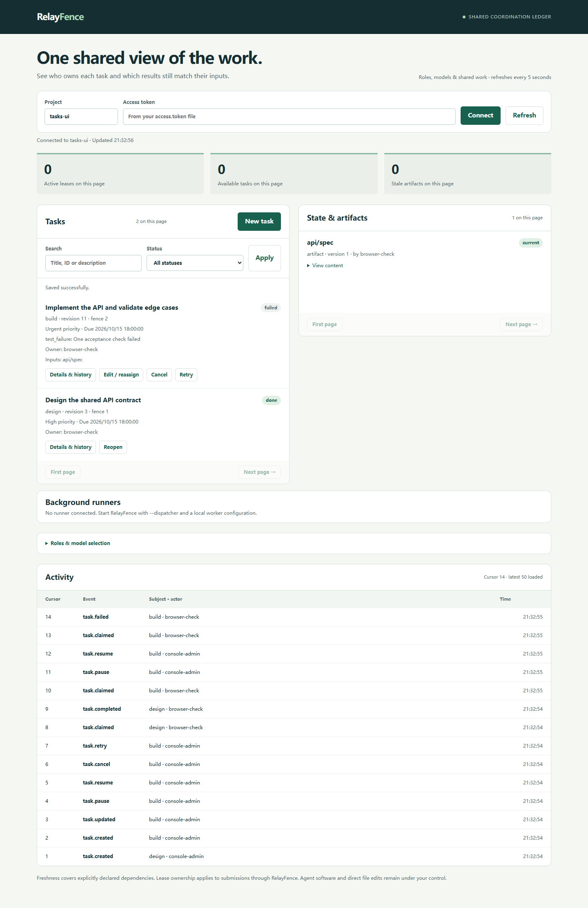

# 任务管理与后台运行 / Task management and background execution

v0.3 增加任务生命周期管理、持续调度和内置 Codex CLI 适配器。完成首次配置后，在控制台创建并分配任务，后台会自动领取满足条件的工作，不需要打开 Codex 桌面聊天窗口。

## 首次接入 Codex

准备 Python 3.11+、仓库依赖，以及已经登录的 Codex CLI。RelayFence 使用现有 CLI 认证，不收集模型账号密码。先启动服务：

```sh
uv sync --locked
uv run relayfence init
uv run relayfence serve
```

在另一个终端执行一次配置命令，替换模型 ID 和工作目录：

```sh
uv run relayfence setup-codex --directory .relayfence/codex-worker --workspace /absolute/path/to/workspace --model YOUR_AVAILABLE_MODEL --agent codex-worker --sandbox workspace-write
```

Windows 使用带引号的绝对路径；如果 `codex` 是 `.cmd` 或 `.bat` 包装器，用 `--executable "C:\absolute\path\to\codex.exe"` 指向实际可执行文件。可选 `--effort high` 会同时登记模型参数并传给 CLI。省略 `--sandbox` 时默认为 `read-only`；写代码任务需要显式的 `workspace-write` 和已可用的本机沙箱。适配器保留已配置的 Windows 沙箱实现，不自动安装沙箱或降低隔离级别。

该命令创建一个 command 模式的实例及同名角色，以及私有的 `agent.token`、`worker.json` 和 `dispatcher.json`。它同时保存配置请求及回执，便于网络响应丢失时使用原请求恢复。配置目录必须不存在，已有实例或角色不会被覆盖。发生部分失败时检查保存的请求与回执，用 `relayfence call` 重放原请求；不要换请求 ID 重复发放凭证。

停止刚才的服务后，以一个命令同时启动服务和后台执行器：

```sh
uv run relayfence serve --dispatcher .relayfence/codex-worker/dispatcher.json
```

也可以保持现有服务运行，在另一个终端独立启动调度器：

```sh
uv run relayfence dispatch --config .relayfence/codex-worker/dispatcher.json
```

需要常驻的是 RelayFence 服务和调度进程；Agent 桌面窗口可以关闭。`dispatch --once` 只做一轮选取并等待本轮任务结束，适合检查配置。

## 在控制台管理任务

打开 `http://127.0.0.1:7433/`，使用本地 `.relayfence/access.token` 连接项目。点击 **New task**，填写标题、任务说明、优先级、截止时间，选择角色，按需填写输入键和前置任务 ID。前置任务必须已经存在。选择由 command 实例负责的角色后，在线调度器会自动领取就绪任务；外部 MCP 会话仍需在对应客户端中触发。

| 显示状态  | 含义与可用操作                                                             |
| --------- | -------------------------------------------------------------------------- |
| Ready     | 可领取；可以编辑、暂停或取消。                                             |
| Blocked   | 前置任务未完成、产物过期或输入缺失；显示具体原因。条件满足后自动解除阻塞。 |
| Running   | 持有有效租约；可暂停或取消，操作会撤销租约。                               |
| Paused    | 不会被调度；可编辑、恢复或取消。恢复后重新执行，不能续接旧模型进度。       |
| Failed    | 保存失败原因与执行目录编号；修正原因后显式 Retry。                         |
| Cancelled | 保留记录与历史，不再执行；可显式 Retry。                                   |
| Done      | 结果已发布；可查看产物或 Reopen 后重做。共享输入变化时标出过期。           |

状态、标题、ID 和说明可以筛选。**Details & history** 展示说明、输入、前置任务、执行快照、产物内容和按任务过滤的事件，可继续分页加载。任务编辑和状态操作都有版本检查，冲突时需要刷新确认。

优先级从 Low 到 Urgent。调度顺序为优先级降序、截止时间升序、创建时间升序；截止时间用于排序和展示，不自动取消逾期工作。新任务不会抢占正在运行的任务。



## 多个角色与执行器

每个执行器使用独立实例凭证。`dispatcher.json` 可以引用多个本地配置文件：

```json
{
  "workers": [
    { "config": "builder.json", "token_file": "builder.token" },
    { "config": "reviewer.json", "token_file": "reviewer.token" }
  ],
  "run_directory": "runs",
  "poll_seconds": 2,
  "max_parallel": 2,
  "request_timeout_seconds": 3
}
```

Codex worker 示例：

```json
{
  "project": "default",
  "agent_id": "codex-worker",
  "adapter": "codex",
  "executable": "/absolute/path/to/codex",
  "cwd": "/absolute/path/to/workspace",
  "sandbox": "workspace-write",
  "timeout_seconds": 600,
  "lease_seconds": 120,
  "heartbeat_timeout_seconds": 5
}
```

路径相对于各自配置文件解析。调度器限制总体并发，同一个工作目录串行执行；文件锁也防止两个本机进程同时占用同一工作目录。需要并行改代码时，给不同实例配置独立 worktree。配置文件修改后重启调度器；角色和模型绑定的修改对后续领取生效。

两个超时字段都是可选项，旧配置继续有效。调度器并发轮询各实例并复用连接，每个实例一轮查询默认最多 3 秒；连接故障独立退避，间隔最多 30 秒。worker 的续租请求使用独立异步连接，默认最多 5 秒，期间本地停止、执行超时和日志检查仍然运行。凭证文件替换后，下一次轮询会重建对应连接；已经开始的执行保留原凭证，原凭证被撤销时会停止。完整边界见[进程与通信机制](process-lifecycle.md)。

DSH、ZCode 和其他软件继续支持外部 MCP 会话；也可按[命令适配器协议](roles-and-models.md#local-command-adapter-apply-the-selection-to-execution)配置后台运行。本版内置启动适配器仅包含 Codex，不能把它解释为已经完成所有厂商的后台接入。

## 结果、取消与恢复

Codex 使用 `exec`、指定模型和结构化结果，详见[官方非交互运行文档](https://learn.chatgpt.com/docs/non-interactive-mode)。结构化结果包含 `outcome`、`summary`、`details`、`files` 和 `checks`。`blocked`/`failed` 会保存为失败任务；只有 `completed` 发布到 `tasks/<task_id>/result`。过长 ID 使用其 SHA-256 作为键中间部分。模型是否如实报告仍需外部验收，RelayFence 不判断代码语义正确性；命令行的模型参数也不作为供应商认证，实际模型证据保留为 unverified。

前置任务的所有产物自动加入后续任务的输入快照。前置任务重新打开或重新执行、共享输入版本变化，都会阻止持有旧快照的工作提交。API 中 `depends_on` 管任务顺序，`inputs` 管共享输入；不要靠标题推断依赖。

取消或暂停先在服务端撤销租约。健康连接下 worker 每至多 3 秒续租检查一次，失去租约会停止其子进程树。Windows 使用带启动门控的 Job Object：适配器获准启动前已纳入管理，适配器提前退出或执行器被强制结束时也会清理普通子孙进程。Linux/macOS 使用独立进程组，在正常退出、超时、取消和可处理的终止信号下清理；执行器被 `SIGKILL` 强制结束不具备相同保证。外部文件、远程系统或脱离管理范围的操作无法撤回；结果仍不能用旧租约提交。

每次执行在私有 `runs/run-*` 中保存输入、声明与完成请求、回执、stdout、stderr；Codex 另存事件和结构化结果。声明回执包含租约凭证，整个目录不可公开。一个实例连接失败不会阻止其他实例领取任务，调度器原子替换本地 `runs/health.json`，保存各实例最近的健康状态和故障退避间隔。Windows 并发读取时可能短暂报文件占用，读取方应重试；健康文件写入失败会在下轮再写，不会中止执行中的任务。控制台显示执行器最近心跳，20 秒内为在线。心跳只更新在线状态，不持续累积请求回执。

执行器停止、模型报错、输出格式错误或超时后，任务记录失败并等待处理，不会自动反复消耗模型调用。完成请求一旦保存，响应丢失时保留原请求，使用相同请求 ID 重放；不要重新运行模型来恢复一次未知的提交。调度器不会自动接管过期 running 任务：先检查私有执行记录，再显式 Retry。重试代表一次新的执行尝试。

从 schema 1/2 升级前先备份并停止旧服务；schema 3 保留任务、租约、凭证和回执，不支持降级。
